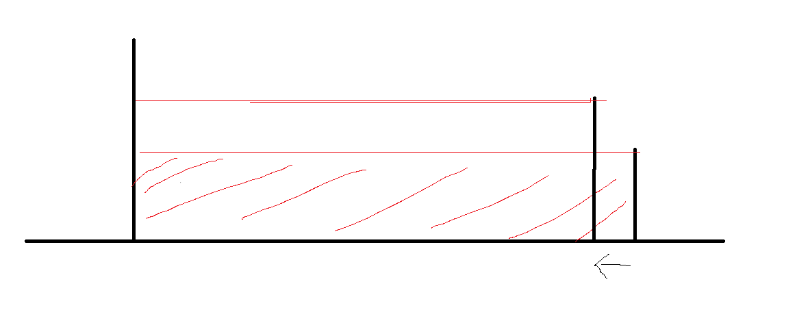

# LeetCode 11. 盛最多水的容器

对应源码：[Hot11_maxArea.java](../src/s2_doubleIndex/Hot11_maxArea.java)

## 题目描述

给定 `n` 根垂线，第 `i` 根的两端是 `(i, 0)` 和 `(i, height[i])`，任意两根线和 x 轴能围成一个装水的容器。求能装最多的那个容器是多少水。

- 容器高度由**两根线里矮的那根**决定（水会从短板溢出）
- 容器宽度是**两根线的下标之差** `j - i`
- 面积 = `min(height[i], height[j]) × (j - i)`

```
[1,8,6,2,5,4,8,3,7] → 49   （下标 1 的 8 和下标 8 的 7：min(8,7) × (8-1) = 7 × 7 = 49）
[1,1]               → 1
```

以 `[1,8,6,2,5,4,8,3,7]` 为例，答案 49 来自下标 1 和下标 8 这两根线（`▓` 是水）：

```
h=8   . █ . . . . █ . .
h=7   . █ ~ ~ ~ ~ ~ █ .      ← 水面被矮的那根 7 钉死，宽 7，面积 7×7 = 49
h=6   . █ █ . . . █ ~ .
      1 8 6 2 5 4 8 3 7
      0 1 2 3 4 5 6 7 8
```



## 💡 大白话解析

暴力的做法是枚举所有两根线的组合，共 $\frac{n(n-1)}{2}$ 对，$O(n^2)$。双指针能一趟扫完，靠的是一个关键判断：**每次只该动矮的那根线。**

`i` 卡最左、`j` 卡最右（此时宽度最大），然后一步步往中间挤。每轮先算当前面积记进 `res`，再决定动谁：

- 哪根线矮，就把它往里挪一格（`i++` 或 `j--`）
- 挪进来后可能换上一根更高的线，容器就有机会变大


---

## 解法：双指针（`maxArea`）

### 核心思想

面积 = `短板高度 × 宽度`。一开始宽度最大，之后每往里走一步宽度都在变小，所以想翻盘只能指望**短板变高**。

这就决定了只能动短板：

- **动短板**：短板可能被换成更高的一根，高度有希望涨上去，抵消掉宽度的损失 → 有机会更大
- **动长板**：短板没变，高度上限还是一样的矮，可宽度却变小了 → 面积只会更小，白走一步

一句话：**长板怎么挪都被短板压着，只有挪短板才可能突破天花板。**

### 为什么是「淘汰短板」而不是「错过答案」（易误解点）

有人会担心：把短板 `i` 挪走，会不会漏掉「`i` 配某个中间位置」的更优解？答案是不会，可以严格排除：

当前 `(i, j)`，设 `height[i] < height[j]`（`i` 是短板）。把所有还剩下的组合分成两类：

```
情况 A：i 不动，j 往里收 → (i, j-1)、(i, j-2)、…
        宽度更小，而高度上限永远 ≤ height[i]（短板还是 i，另一根不管多高都被 i 卡住）
        ⇒ 面积必然比当前 (i, j) 还小，可以放心全部淘汰

情况 B：i 往里走 → (i+1, j)、(i+2, j)、…
        短板换人了，高度有可能变高，保留了翻盘的可能
        ⇒ 所以只挪 i，把这些候选留给后面几轮去检验
```

结论：固定短板 `i` 去配任何更窄的位置，都是稳赔的，直接一次性淘汰；只有挪开短板，才把「可能有解」的那批候选留下。**这正是双指针敢一趟走完、不遗漏最优解的底气。**

### 完整追踪 `[1,8,6,2,5,4,8,3,7]`

每轮都是「先算面积刷 `res` → 再动短板」：

```
i=0(1)  j=8(7)  h=1 len=8 area=8   → i 短，i++    res=8
i=1(8)  j=8(7)  h=7 len=7 area=49  → j 短，j--    res=49  ★最大
i=1(8)  j=7(3)  h=3 len=6 area=18  → j 短，j--    res=49
i=1(8)  j=6(8)  h=8 len=5 area=40  → 相等，j--    res=49
i=1(8)  j=5(4)  h=4 len=4 area=16  → j 短，j--    res=49
i=1(8)  j=4(5)  h=5 len=3 area=15  → j 短，j--    res=49
i=1(8)  j=3(2)  h=2 len=2 area=4   → j 短，j--    res=49
i=1(8)  j=2(6)  h=6 len=1 area=6   → j 短，j--    res=49
最终 res = 49
```

### 代码实现

```java
public int maxArea(int[] height) {
    int i = 0;                    // 左指针
    int j = height.length - 1;    // 右指针
    int res = 0;
    while (i < j) {
        // 高度由短板决定
        int h = Math.min(height[i], height[j]);
        // 注意底的取值：宽度是下标之差 j - i，不是 j - i + 1
        int len = j - i;
        res = Math.max(res, h * len);

        // 谁短动谁：移动短板才可能突破高度天花板
        if (height[i] < height[j]) {
            i++;
        } else {
            j--;
        }
    }
    return res;
}
```

---

## 复杂度分析

| | 双指针 | 暴力枚举 |
| :--- | :---: | :---: |
| 时间 | $O(n)$，两指针合计移动 `n-1` 步 | $O(n^2)$，枚举所有线对 |
| 空间 | $O(1)$，只用几个变量 | $O(1)$ |

---

## ⚠️ 易错点

### 1. 宽度是 `j - i`，不是 `j - i + 1`

容器夹在两根线**之间**，底边长度就是下标差。写成 `j - i + 1` 会凭空多算一格。实测 `[1,1]`：正确答案 1，写成 `j - i + 1` 得到 2。

源码里那句 `// 注意 底的取值 !!!` 就是提醒这一点。

### 2. 先算面积，再移动指针

顺序反了会漏掉当前 `(i, j)` 这一步的面积。移动指针前一定要用当前的 `i`、`j` 刷一次 `res`。

### 3. 动短板，不是动长板

条件必须是「`height[i] < height[j]` 就 `i++`」，即矮的那一侧往里走。写反成移动长板，等于在高度不变的情况下白白缩短宽度，一定错过更优解。实测 `[1,8,6,2,5,4,8,3,7]`：正确 49，若改成「动长板」得到 8。

### 4. 两端相等时动谁都行

`height[i] == height[j]` 时，进 `else` 分支 `j--` 或改成 `i++` 都不影响最终结果——因为另一侧那根等高的短板还在，淘汰谁都不会漏解。

---

## 🔗 相关题目

- [接雨水](Hot42-接雨水.md) —— 同样两头往中间挤的双指针，但那题算的是「每格头顶能蓄多少水」，比的是历史最高墙 `leftmax/rightmax`
- [三数之和](Hot15-三数之和.md) —— 排序后左右夹逼的另一道经典双指针题

## 🧠 记忆口诀

```
面积 = 短板 × 宽度，水从矮的那边溢
两头往中间挤，先算再挪别忘了
谁矮就挪谁，长板一动准变小
宽度是 j-i，别多加那个 1
```
